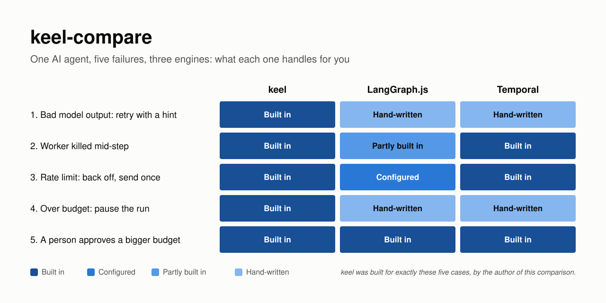
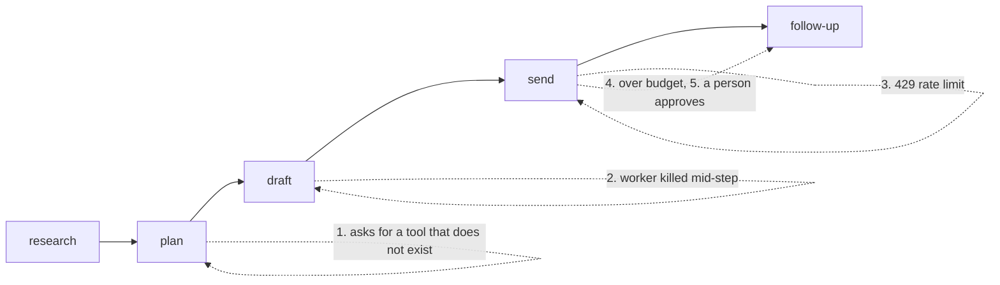

# keel-compare


The same AI agent workflow built three times: in [keel](https://github.com/yodablocks/keel),
in LangGraph.js and in Temporal. Each version hits the same five failures in one run.
The question is simple: **what does each tool handle for you, and what do you write by hand?**

<p align="center">
  
</p>

> [!NOTE]
> I wrote keel, and keel was designed for exactly these five cases. Read the comparison with that
> in mind. Where LangGraph or Temporal does better, this README says so.

## In short

- **Temporal has the best crash recovery.** The server notices a dead worker by its missed heartbeat and hands the step to another one.
- **LangGraph has the best human-in-the-loop API.** `interrupt()` in any node, resume with any value.
- **Neither one knows about bad model output or budgets.** Both retry a hallucinated tool call with the same input unless you write the loop yourself, and spend tracking is hand-written in both.
- **All three finish the run at the same cost, $0.15.** Transcripts are in [`transcripts/`](transcripts/).

## The workflow

A research agent runs five steps against a scripted model and scripted tools ([`shared/world.ts`](shared/world.ts)),
so every version sees the same failures at the same points:



| # | Moment | Pass criteria |
|---|--------|---------------|
| 1 | Bad model output | The retry is different from the first try: the error goes back to the model as a hint |
| 2 | Worker crash | A second worker finishes the run; `research` and `plan` do not run again |
| 3 | Rate limit | The run backs off and the email goes out once, under a stable idempotency key |
| 4 | Over budget | `follow-up` does not start; the run pauses and asks a person instead of failing |
| 5 | Approval | A reviewer raises the budget and the run completes at $0.15 |

Full spec and fairness rules: [SPEC.md](SPEC.md).

## Results

| Moment | keel | LangGraph.js | Temporal |
|--------|------|--------------|----------|
| **1. Bad output, retry with a hint** | **Built in.** Classifier labels it `bad_output`, policy retries with the error as a hint | **Hand-written.** The node catches the error, puts a hint in state, a conditional edge loops back. The default `retryOn` would retry it blindly | **Hand-written.** Mark the error type non-retryable, catch it in the workflow, call the activity again with a hint |
| **2. Worker killed mid-step** | **Built in.** Lease expires, worker B resumes from stored steps | **Partly built in.** `invoke(null)` resumes from the last checkpoint without rerunning finished nodes. Nothing detects the crash: no lease, no queue, so you decide who resumes and when | **Built in.** Worker B gets the activity after A misses its 1.5s heartbeat; the workflow replays from history. The activity has to send heartbeats itself |
| **3. Rate limit, send once** | **Built in.** Classified `transient`, backoff, idempotency key per step | **Configured.** Per-node `retryPolicy` with backoff, filtered to rate limits. Idempotency key built by hand from `thread_id` | **Built in.** Activity retry policy with backoff (retries everything by default). Idempotency key built by hand from the workflow ID |
| **4. Over budget, pause** | **Built in.** Per-run budget; `over_budget` escalates to an approval | **Hand-written.** Spend tracked in state; a gate before each node calls `interrupt()` | **Hand-written.** Spend tracked in the workflow; a gate before each activity waits on `condition()` |
| **5. Person approves** | **Built in.** `setRunBudget` + `resolveApproval` | **Built in.** `interrupt()` pauses, `Command({ resume })` carries the decision and the new budget | **Built in.** A signal carries the decision; a query shows why it is waiting |
| Failure record | Every attempt, with its classification and action | Only what you write to state | Final failure per activity. Retried attempts (the crash, the 429) are not in the history |
| Infra | Postgres | Postgres (checkpointer) | Temporal server (the dev server is in-memory; production needs its own database or Temporal Cloud) |

## What each one does well, and where it falls short

### LangGraph.js

**Does well**
- Human in the loop is the strongest part. `interrupt()` inside any node, resume with any value, and the paused state is inspectable with `getState()`.
- Resuming after a crash needs no extra code once a Postgres checkpointer is set: finished nodes are not rerun.
- The graph is explicit. The bad-output loop is a visible edge (`plan -> plan`), not a hidden retry.

**Falls short**
- No process model. When a worker dies, the thread sits at `next: ["draft"]` until something you wrote calls `invoke(null)` on it. LangGraph Platform adds a server and queue for this; the open-source library does not.
- The default `retryOn` retries almost any error, including bad model output, with the same input.
- Checkpoint durability defaults to `"async"`, and that can lose a finished step. Tested with a worker killed right after a node finished: `"async"` lost the node 20 times out of 20 and it ran again on resume; `"sync"` kept it every time. The window is short (under 10 ms on a local Postgres, roughly one database write; longer with a remote database), but a step that sent an email or charged a card would do it twice. A crash a few ms later can also leave `getState()` showing nothing left to run while `invoke(null)` still finishes the run. This port uses `"sync"`. Script: [`langgraph/durability-check.ts`](langgraph/durability-check.ts), results: [`transcripts/langgraph-durability.txt`](transcripts/langgraph-durability.txt).
- No budget concept. Spend lives in state and the gate is about 15 lines in [`langgraph/graph.ts`](langgraph/graph.ts).
- Node names cannot match state keys (`research`, `plan`, `draft` had to become `findings`, `toolCall`, `brief`).

### Temporal

**Does well**
- Crash recovery is the best of the three. Workers poll a queue; the server notices a dead worker by heartbeat timeout and hands the activity to another one. The workflow replays from history without rerunning finished steps.
- Retries with backoff come with every activity, configured in one place.
- Signals and queries make the approval step simple, and `condition()` waits durably for as long as needed.
- It is the most mature of the three by far.

**Falls short**
- The workflow runs in a deterministic sandbox and cannot import `shared/world.ts` (it uses Node timers). Activities return their cost so the workflow can add it up.
- Bad model output has no special handling. The default policy retries every error with the same input.
- No budget concept, same as LangGraph.
- Retries are invisible in the history: only the last failure of each activity is recorded. The demo's history shows the bad-output failure and nothing about the crash or the 429.
- Crash detection needs heartbeats from the activity itself. Without them, a dead worker is only noticed at `startToCloseTimeout` (30s here).

## What keel does differently

- **Failures are classified** (`bad_output`, `transient`, `over_budget`, ...) and the policy picks the action from the class. In the other two, each failure type is a separate hand-written path.
- **A retry can change the input:** the error goes back to the model as a hint. Both others resend the same call unless you write the loop yourself.
- **Budgets are part of the engine.** Steps report usage, and going over turns into an approval instead of an error.
- **Every attempt is stored** with what happened and what the engine decided. That record is what makes evaluating the classifier possible.
- **It only needs Postgres.** Temporal needs its own server; LangGraph needs nothing but leaves process management to you.

## What I would change in keel

Building the same agent in the other two showed me where keel is weaker, not just where it is different.

- **Per-step failure settings.** Temporal and LangGraph let each step declare its own retries (`maxAttempts`, `nonRetryableErrorTypes`, `retryOn`). keel has one classifier and one policy per worker, so step-specific behaviour means branching on `ctx.step` inside the policy. I would add a `failure` option to `ctx.step.run` that maps known error types to actions, and leave the classifier for the errors nobody planned for.
- **Be honest about what "built in" rests on.** keel handles moment 1 because a classifier recognises the error. On 75 real error messages from public SDK issues, the classifier keel ships picks the right failure kind about 6 times in 10 and the right action about 8 times in 10 ([keel's results](https://github.com/yodablocks/keel#failure-classification-rules-vs-jev)). The hand-written paths in LangGraph and Temporal are dull, but always right for the errors they name. That is another reason for the point above: the declared paths should come first.
- **Stop a step before it overspends, not after.** In all three runs the `send` step took spend to $0.13 against a $0.125 budget, and the gate only caught it before the next step. keel accepts this overshoot because a step's cost is known only after it runs. An optional cost estimate on a step would let the budget check happen before an expensive call.
- **Make pausing impossible to swallow.** keel pauses a run by throwing (`RunSuspended`, `LeaseLostError`), so a `try/catch` around a step that swallows them can complete a budget-paused run with steps skipped. LangGraph's `interrupt()` throws too and has the same trap. Temporal does not: waiting is an `await condition()`, not an exception. keel's own risk list already suggests a non-Error signal or a lint rule; this comparison is a good reason to do it.

## Run it

Needs Node 24+, pnpm and Docker. The Temporal demo also needs the [Temporal CLI](https://docs.temporal.io/cli) (`brew install temporal`).

```sh
pnpm install
pnpm test                              # checks the scripted world

docker compose up -d                   # Postgres on port 5434
pnpm demo:langgraph                    # LangGraph port, five moments in one run
pnpm check:durability                  # does "async" checkpointing lose a step on a crash?

temporal server start-dev --headless   # in another terminal
pnpm demo:temporal                     # Temporal port
```

keel's own demo lives in the [keel repo](https://github.com/yodablocks/keel) (`pnpm demo`).

## Repo layout

```
shared/world.ts      scripted model and tools, the same for every port
langgraph/           StateGraph + Postgres checkpointer, worker, demo harness
temporal/            workflow, heartbeating activities, worker, demo harness
transcripts/         one recorded run per port
scripts/             generates docs/images/matrix.svg (pnpm images)
SPEC.md              the workflow, the five moments, fairness rules
```

## License

MIT
